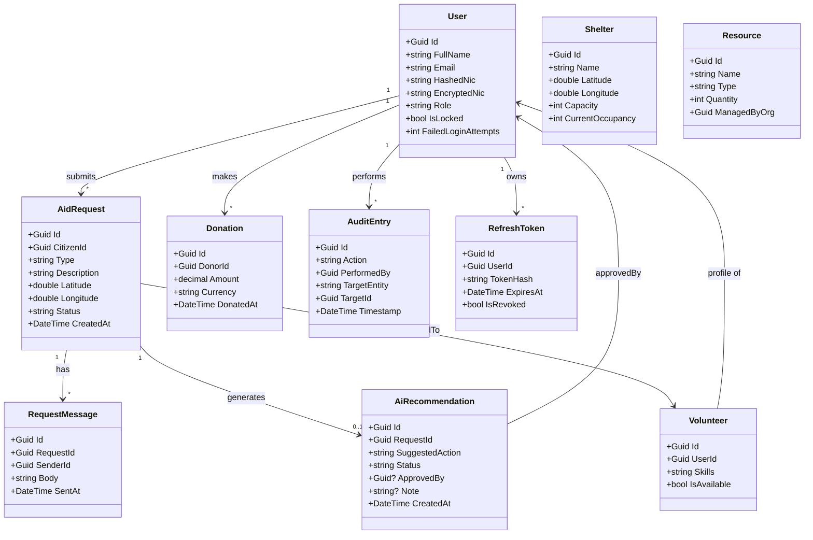
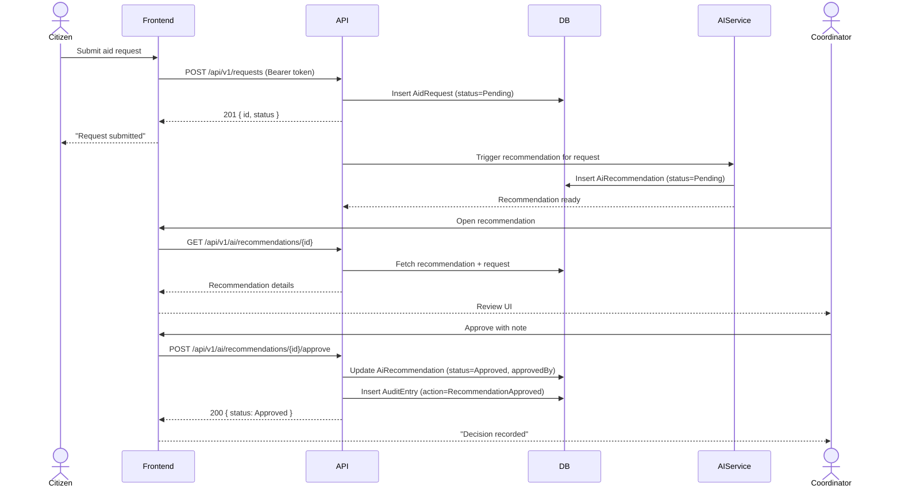
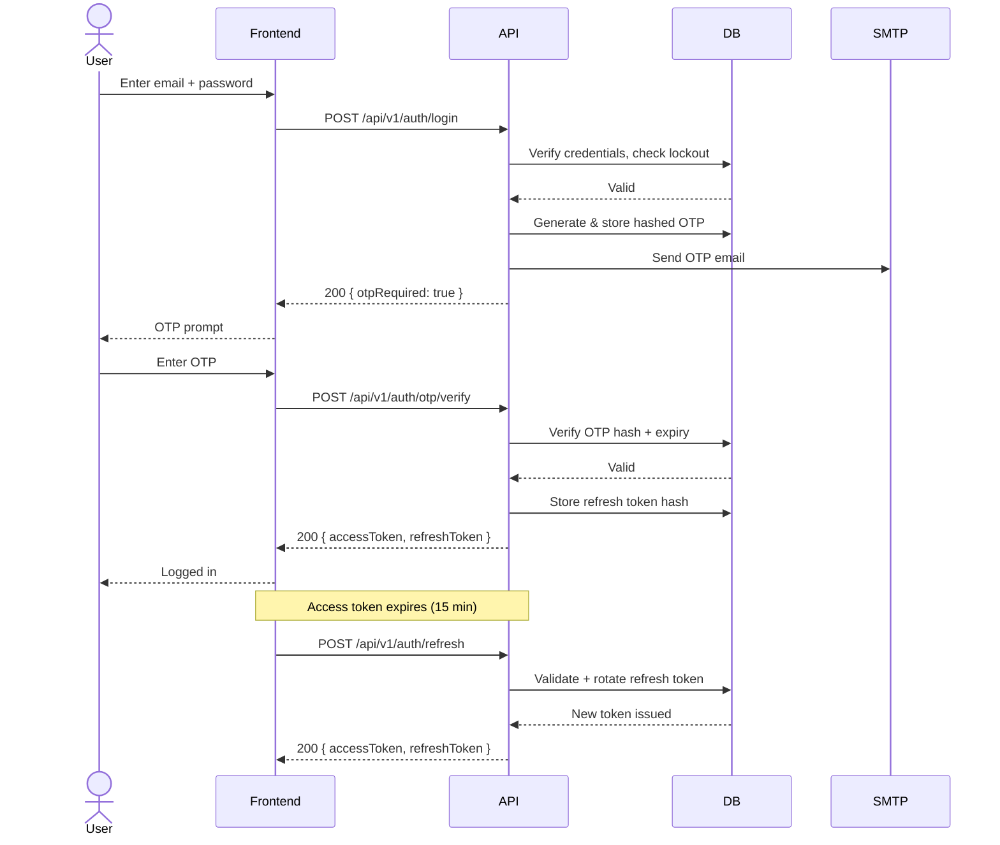
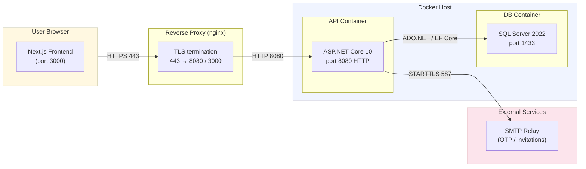

# Diagrams — Crisis Aid Platform

All diagrams are written as [Mermaid](https://mermaid.js.org) code so they render directly in GitHub Markdown and can be diffed like source code.

---

## Class Diagram

Core domain entities and their relationships.

---

## Sequence Diagram — Request Lifecycle with Human-in-the-Loop

---

## Sequence Diagram — Authentication Flow (OTP + JWT)

---

## Deployment Diagram

---

## Notes

- Diagrams are rendered automatically by GitHub Markdown.
- To preview locally install the [Mermaid CLI](https://github.com/mermaid-js/mermaid-cli): `npm i -g @mermaid-js/mermaid-cli` then `mmdc -i docs/diagrams/diagrams.md`.
- When the architecture changes, update the relevant diagram in the same PR as the code change.
